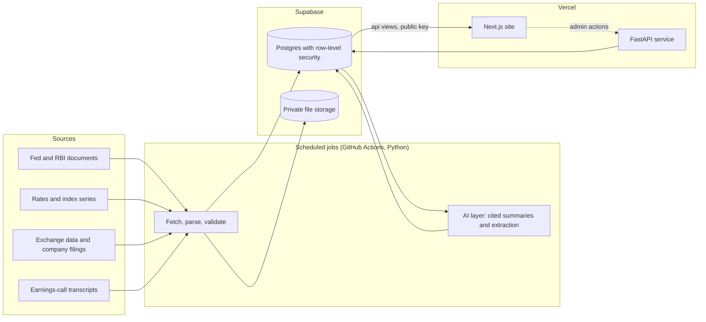

# Finance Terminal

An AI research terminal for Indian markets and the Fed–RBI policy cycle.

**Live site: <https://finance-terminal-phi.vercel.app>**

Every number on it traces back to an official source, and anything the project can't verify is labelled or left out.
It is a student project by Anand Benny, built to show how a research tool for rates and equities can use AI without
letting it invent facts. The code is public so it can be read; the design lives in a set of planning documents that
are not part of this repo.

**Informational only, not investment advice.** Nothing here is a recommendation to buy or sell anything.

## What is built

**Fed vs RBI policy tracker.** Every Fed (FOMC) and RBI (MPC) decision on one page: where rates stand, the latest
decisions side by side, and the history. Each meeting has its own page with the statement or resolution, a redline of
what changed against the previous one, the minutes, the vote, and how markets moved around the decision. Decision days
are picked up by a watcher that polls for the statement, so a decision appears without anyone pressing a button.

**Nifty 50 screener and valuation.** A screener over the 50 companies with labelled columns and the snapshot's date,
and a page per company: overview, financials parsed from results filings, a valuation tab, and the company's
sensitivity to rate decisions. Valuation shows what the market price implies (a reverse DCF for operating companies, an
implied return on equity for lenders) with every assumption listed with its date and source. It gives no target price,
no upside and no buy or sell view.

**Earnings calls.** For each Nifty 50 company's latest quarterly call: a cited summary, and the figures and guidance
management stated, each with its quote and a link to the page of the source PDF it came from. A list page shows every
company's latest call. Guidance is recorded against what the company later delivered.

**Accuracy and methodology pages.** `/accuracy` shows the project's own data-quality and AI-quality measures, and
`/methodology` explains how figures and AI text are made, checked and traced, and what the site cannot do.

## How AI is used, and how it is checked

AI writes short summaries and extracts structured facts from documents. It is never the source of a number.

- **Cited or dropped.** Every claim must carry a citation into the stored source text; a claim without a verified
  citation is dropped, and the database refuses to publish an uncited output. Quotes shown to a visitor are rebuilt
  from the stored text, never taken from the model's own words.
- **Numbers only from the passage.** AI text may contain only numbers that appear in the passage it cites or in the
  rows the database returned.
- **Gates before anything is shown.** Model outputs are measured against hand-checked sets, with the pass rule fixed
  before any run. A field produced by a model stays hidden by default (a field with no published policy is hidden)
  and appears only after a person has looked and the check it was held back for has passed. A feature that is still
  waiting for that look is therefore not showing yet.
- **Human oversight.** A named person decides what is published; the owner is accountable for it.
- **It degrades, it doesn't break.** The AI work is precomputed in batches and stored, and the site makes no live AI
  call for a visitor. With no key or no credit left, the AI steps skip with a recorded reason, nothing is lost, and the
  pages show labelled states such as "AI summary not generated yet".
- **Spend is capped.** One wrapper makes every model call, with a monthly budget switch and no repeated requests for an
  unchanged input.

## Architecture



Raw files are stored once and never overwritten; changed values go through a revision log. A load whose blocking checks
fail rolls back, the last good data stays, and visitors see "Update delayed" rather than bad numbers. The browser talks
only to the site and to the database's public `api` views, never to a data source.

## Data sources

Fed documents come from the Federal Reserve Board; RBI documents from the Reserve Bank of India (named by document, date
and press-release number rather than linked); rates and exchange rates from the Treasury, the Federal Reserve Board and
OECD via FRED; index levels from their index owners via Yahoo Finance, end-of-day only; Nifty 50 prices and company
data from NSE (every NSE-derived figure says "Source: NSE") and company filings. The full list, with each source line,
is on the site's **About and privacy** page. This is a non-commercial student project: NSE data is fetched weekly at
most, cached, never exported, and removed at once if NSE objects.

## Limitations

Figures stay in their reporting currency and are never compared across currencies. Index levels are end-of-day.
Valuation and rankings are informational. AI text can be incomplete, and a missing summary means nothing passed the
checks. The full list is on the site's `/methodology` page.

## Tech stack

Next.js 16 and React 19 with Tailwind 4; Lightweight Charts and TanStack Table; Python 3.13 (uv) for jobs and the
FastAPI service; Supabase (Postgres with pgvector, row-level security, storage); Vercel for hosting; GitHub Actions for
the schedule and CI; Anthropic's Claude models behind a single wrapper.

## Data and ownership

Every piece of data on the site belongs to its owner, and the owner is named on each figure. This is a non-commercial
project: it earns no money, and it sells, licenses or exports no data. That is a promise of no monetary gain and no
data resale, not a claim that nothing is shown, and it does not replace permission. If you own data shown on the site
and want it removed, it is removed.

**No raw source data is in this repo**: no saved exchange or regulator pages, no downloaded data files, no exports. The
jobs fetch from official sources on a low-frequency, cached schedule and keep what they need in the project's own
private storage and database; the browser never calls a data source.

**Licence:** none is granted. The code is published for reading, so all rights are reserved.

## What is in the repo

| Path | What |
|---|---|
| `supabase/migrations/` | the database schema |
| `supabase/tests/` | the SQL security and integrity tests; `run_all.sh` builds a throwaway database and runs them |
| `py/` | one Python project (uv, Python 3.13): data jobs, the AI layer, the live API service, evaluations |
| `web/` | the Next.js front end |
| `.github/workflows/` | the scheduled data jobs, the keep-alive and CI |
| `vercel.json` | one Vercel project, two services: `web` at `/`, `api` at `/api/*` |

## Run the tests

```bash
cd py && uv sync --locked --all-extras
PGHOST=localhost PGPORT=5432 ../supabase/tests/run_all.sh          # needs a throwaway Postgres 15+ with pgvector
TEST_PG_CONNINFO="host=localhost port=5432 dbname=ft" uv run --locked pytest -q
```

Some Python tests read saved source pages from a separate private repository, so they skip without it. In CI, a pull
request from a fork has no access to that repository, so its test job stops at the step that fetches the saved pages.

## More

- [`docs/DEMO.md`](docs/DEMO.md): a two-minute demo script.
- [`docs/OPERATIONS.md`](docs/OPERATIONS.md): secrets, accounts and the runbook for running without a Claude subscription.
